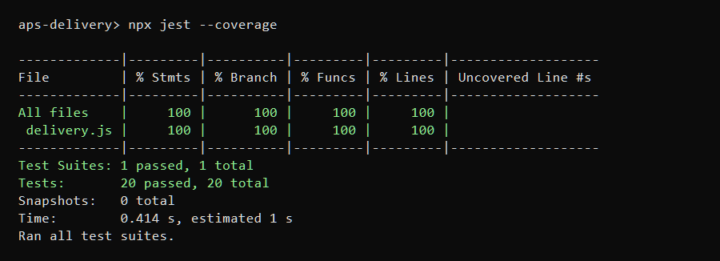

# DeliveryExpress

APS de Teste de Software (UNIFAMETRO): cinco funções de um sistema de delivery cobertas pelos 20 casos de teste do [enunciado](https://profjonhsousa.vercel.app/2026-2/unifametro-ts/aulaAPS/pratica/index.html).

João Tiago Mesquita Palhas (1-2023228650)

```sh
npm ci
npx jest --coverage
```


